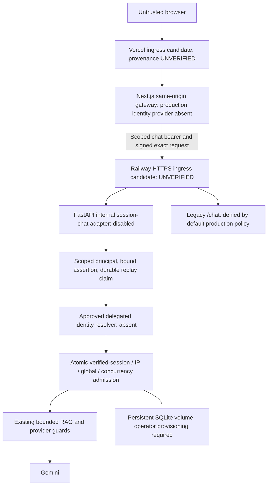

# Production trust boundary and legacy isolation

Phase 6B-4G-3 is a local security review and legacy-isolation implementation.
Public chat remains disabled. Vercel, Railway and their proxy behavior are
**unverified hosting candidates**: no external documentation or services were
accessed for this review. This document makes no provider availability, pricing,
header-sanitization, private-network or isolation guarantees.

## Observed architecture

The browser, public network, request headers and gateway process are separate
trust boundaries. The backend network peer identifies the gateway/proxy, not the
original visitor. Uvicorn remains configured with `--no-proxy-headers`; it does
not establish visitor identity from forwarding metadata.

`TrustedVisitorIdentityProvider` in the frontend has no production implementation
or environment selector. It requires canonical IP, approved policy, request-bound
`requestId` and `evidenceId`; the gateway invokes the base implementation rather
than trusting an overridden validator. Request context includes body/session
hashes and a server request ID. Neither a familiar header nor a fixture provider
proves provenance.

The backend `GatewayAuthority` binds credential identity, issuer, audience,
signing-key IDs, capability and ingress policy. `TrustedIdentityResolver` checks
a sealed context and exact policy, invokes independently composed authorization,
and constructs identity only afterward. Caller-provided ASGI state, forwarding
headers and a valid signature cannot select a resolver. No resolver is selected
by environment configuration. Without trusted composition, enabled HTTP startup
fails; ordinary configuration leaves the reserved adapter disabled.

Python seals and trusted composition protect the HTTP boundary, not against
malicious code already executing inside the backend process.

## Recommended delegated identity model (not implemented)

A cross-provider setup needs explicit delegation: authorize a specific gateway
and its approved ingress policy to attest visitor identity. The backend cannot
independently recover the visitor address from a Vercel-to-Railway socket.

1. Independently establish which ingress supplies authoritative visitor metadata,
   and prove public clients cannot supply or override it on any reachable path.
2. A narrowly scoped server-side frontend provider consumes that trusted evidence
   and binds its result to the current request. No general header fallback.
3. Existing HMAC assertions bind the canonical IP and policy to exact method,
   path, session and transmitted body bytes, issuer, audience, key and nonce.
4. The backend accepts only an explicitly approved gateway/policy mapping using
   the scoped credential, verified assertion and durable replay claim. A reviewed
   resolver authorizes the delegation under that mapping before admission.
5. Atomic session/IP/global/concurrency checks and emergency controls remain
   mandatory. Direct backend callers cannot replace any of these steps.

This model trusts the approved gateway's implementation and secret custody.
Compromising its bearer plus signing key can forge assertions and IP identities;
global budgets and concurrency remain additional restrictions. The existing
assertion protocol does **not** transmit frontend `evidenceId` or its request ID.
It authenticates the IP/policy statement, not independently verifiable edge
attestation. If independent edge attestation is required, the present protocol
is insufficient; review that separately rather than inventing a resolver here.

Keep scoped secrets server-only and distinct from issuance, legacy, IP HMAC and
Gemini secrets. Rotate through an approved current/previous signing-key window,
update the explicit authority mapping, and revoke compromised credentials/keys.
Replay identifiers include key scope: do not retry a consumed request with a new
key/nonce. No credential fallback is permitted.

## Hosting evidence required before approving a resolver

| Boundary | Required evidence and later controlled validation |
| --- | --- |
| Vercel ingress | Current official guarantees for the authoritative client-address source; stripping/overwriting attacker values; exact semantics for IPv4, IPv6, mapped addresses, lists and proxy hops |
| Reachable frontend paths | Confirm production, preview, custom domains and alternative deployment URLs cannot bypass the approved ingress; account for CDN/proxy chains and custom rewrites |
| Spoofing resistance | Synthetic requests containing conflicting/duplicate forwarding headers, IPv4/IPv6, malformed values and multiple hops must not let visitors choose the identity |
| Request provenance | Demonstrate trusted evidence belongs to this request; document extraction and immutable handoff into the existing provider interface |
| Railway ingress | Current HTTPS/service exposure, request-header forwarding and any network restrictions; ensure infrastructure-added forwarding headers do not conflict with the adapter's strict rejection policy |
| Private networking | Verify actual cross-provider reachability and cost before relying on it; do not assume Vercel can access Railway's private network |
| Backend deployment | Immutable reviewed image, required runtime modules, one worker/instance, no alternate process/port exposing a different app or legacy service |
| Persistent storage | Durable mounted SQLite path outside read-only app/index, correct owner/permissions, supported SQLite locking and backup/recovery; no ephemeral replacement DB |

No controlled ingress tests, provider documentation verification, image build or
cloud configuration were performed in this phase. Approving a policy string or
signing a header is not sufficient evidence. IPv4-mapped IPv6 normalization must
match both existing implementations; invalid/noncanonical addresses fail closed.
NAT/shared IPs, VPNs and rotating networks mean an IP is neither a unique human
nor a reliable identity credential.

## Explicit legacy execution policy

New backend-only settings, without changes to real environment files:

| Setting | Default | Meaning |
| --- | --- | --- |
| `BACKEND_DEPLOYMENT_POLICY` | `production` | Exactly `production` or `staging`; operator-controlled authorization policy, not inferred host detection |
| `LEGACY_CHAT_ENABLED` | `false` | Exactly `true` or `false`; explicit legacy execution request |

Production policy always denies legacy execution, including when credentials are
valid. Combining production policy with an enabled legacy flag fails configuration
validation. Staging alone does not enable legacy execution. An enabled legacy
route requires explicit staging policy, enabled bearer authentication and a valid
staging token; missing/malformed configuration fails closed. Legacy execution and
`SESSION_CHAT_HTTP_ENABLED=true` cannot be combined in one configuration.

The policy is checked during configuration loading and lifespan startup, in the
shared HTTP supervisor before body/admission/provider work, and in the `/chat`
handler before the worker. The route stays registered for staging compatibility,
but is inert by default. Only exact `POST /chat`, without query, root-path or raw
path aliases, is executable under authorized staging. Trailing slashes, normalized
aliases and unsupported methods never redirect into execution. Earlier anonymous
local `/chat` behavior is deliberately removed. Existing offline staging tests
now explicitly select authenticated staging fixtures.

The secure service reuses a private callback supervisor with a server-constructor
marker; it does not dispatch through the public `/chat` handler. Request headers
and ASGI state cannot select that marker. Scoped chat/issuance credentials remain
invalid for legacy routes, and legacy credentials remain invalid for secure chat.
Health/readiness exemptions and existing issuance policies are unchanged.

The operator can still misconfigure a deployment as staging: software cannot
infer its physical hosting environment from a policy string. Promotion review
must verify image defaults and actual runtime overrides, pin production policy,
leave legacy disabled, exclude the legacy credential from production gateways,
and prevent a separate old deployment from remaining provider-capable. This is
an explicit administrative boundary, not an assertion that environment variables
prove a trusted ingress. `NODE_ENV`, Host and forwarding headers do not affect it.

## Deployment configuration safety review

- All existing public execution flags remain off by default. Backend HTTP chat
  additionally requires capability mode, session service, session admission, IP
  admission and trusted composed pipeline/resolver; no one flag bypasses these.
- Production legacy policy does not automatically enable or secure other flags.
  Keep bot verification, issuance and frontend chat opt-ins independent and off
  until their deployment review is complete. No public activation procedure is
  supplied here.
- Pin scoped credentials, assertion issuer/audience/key ring/policy and time
  requirements consistently. Missing keys, replay storage or identity fail closed.
- Provision schema-6 storage only through existing explicit maintenance procedures
  with workers stopped and paid usage disabled. Never auto-create/migrate/reset
  an operational DB. SQLite must reside on a durable volume owned by UID10001,
  outside `/app` and RAG data. Do not bake a ledger into an image.
- Initial deployment is one persistent instance and one worker, no autoscaling.
  Multiple independent volumes do not share global budgets/replay state. Scaling
  requires a separately designed shared authoritative store or proven shared
  SQLite filesystem/locking arrangement; do not infer this from platform names.
- Preserve index/source matching, checksums, read-only packaged data, non-root,
  provider timeouts, request deadline, no retries, worker-owned capacity cleanup,
  conservative no-refund accounting and persistent emergency disable.
- `/health` is process liveness; `/ready` currently checks application/index
  readiness, not paid-chat availability. Disabled usage, depleted quotas or ledger
  failure may coexist with readiness200. Consider a separate sanitized operator
  availability signal; emergency shutdown should not be treated as a crash.
- Request budgets limit admitted work, not exact monetary spend. Provider quotas,
  runtime-secret protection, alerts and manual emergency procedures still need
  deployment validation; alerts are not hard spending caps.

The Dockerfile now explicitly copies security modules already present in the
release manifest, plus the new policy module. Previously those modules were
missing from the final image despite being present in its release context.
Static tests compare the COPY list and `.dockerignore` source exceptions to the
runtime manifest. A local network-disabled scratch export verified actual Docker
context filtering, all 18 index chunks and release checksums. Base/dependencies,
non-root user, single worker and APT removal are unchanged. A full application
image rebuild, runtime test and vulnerability scan remain outstanding; production
deployment has not been tested.

## Next steps

1. Review and retain these default-deny legacy controls; keep all public flags off.
2. Authorize current official hosting-documentation research and choose ingress.
3. Establish the evidence above using isolated spoofing/provenance tests.
4. Review frontend extraction and backend delegated resolver separately; add
   offline negative tests before any runtime composition is approved.
5. Verify runtime configuration, durable storage, release image, rollback and
   emergency procedures in protected staging before considering public chat.
